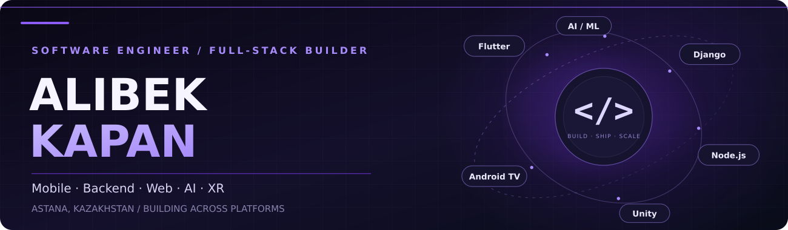

  

  
<strong>Flutter & Mobile • Backend • Web • AI • Interactive Technology</strong>

  

    
    
    
  

## ⚡ Tech stack

### 📱 Mobile & cross-platform

`Flutter` · `Dart` · `BLoC / Cubit` · `Android TV` · `Android / iOS` · `Platform Channels` · `HLS / M3U8` · `Firebase` · `Push Notifications`

### 🐍 Backend & APIs

`Django REST Framework` · `REST` · `GraphQL` · `WebSockets` · `Celery` · `Background Jobs` · `Auth` · `API Integrations`

### 🌐 Web & frontend

`Responsive UI` · `Dashboards` · `Static Sites` · `API-driven Web Apps`

### ☁️ Databases, infrastructure & DevOps

`SQL` · `Neon` · `DigitalOcean` · `CI/CD` · `Docker` · `Deployments` · `GitHub Actions`

### 🤖 AI, agents & automation

  
  

`Agentic Coding` · `AI-Assisted Engineering` · `LLM APIs` · `OCR` · `Speech-to-Text` · `NLP / Sentiment Analysis` · `Automation`

### 🎮 Game development & XR

`Unity` · `C#` · `AR / VR` · `Interactive 3D` · `Computer Graphics` · `Game Development`

### 🛠️ Developer tools & platforms

`Xcode` · `Jira` · `macOS` · `Linux` · `Windows` · `Debugging` · `Profiling` · `Testing` · `Release Management`

  
<b>🧠 Engineering knowledge & foundations</b>

   

  `System Design` · `Software Architecture` · `Design Patterns` · `OOP` · `Data Structures & Algorithms` · `Concurrency & Async` · `Operating Systems` · `Databases` · `Networking` · `Discrete Math` · `HCI` · `UI/UX` · `Computer Graphics` · `AI Fundamentals`

